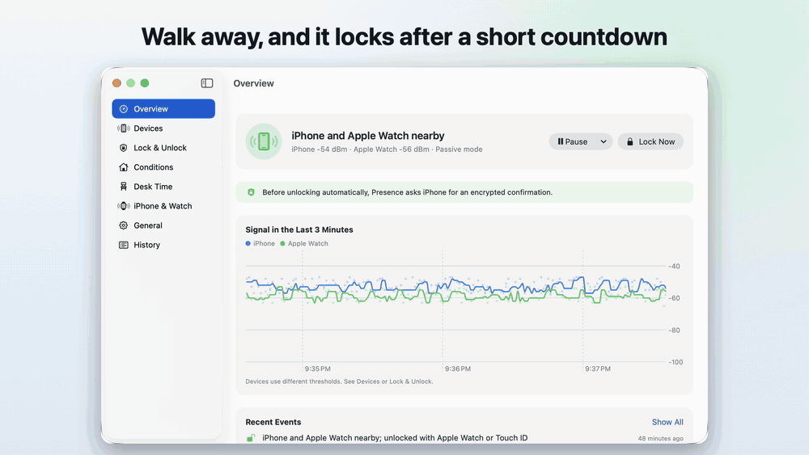
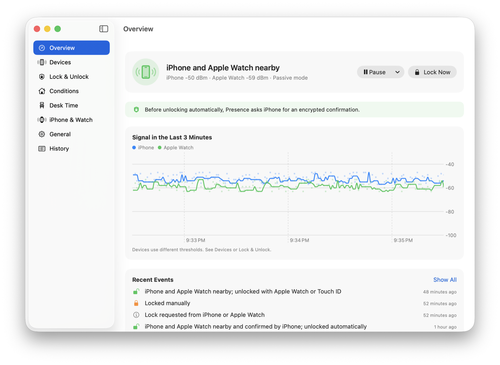
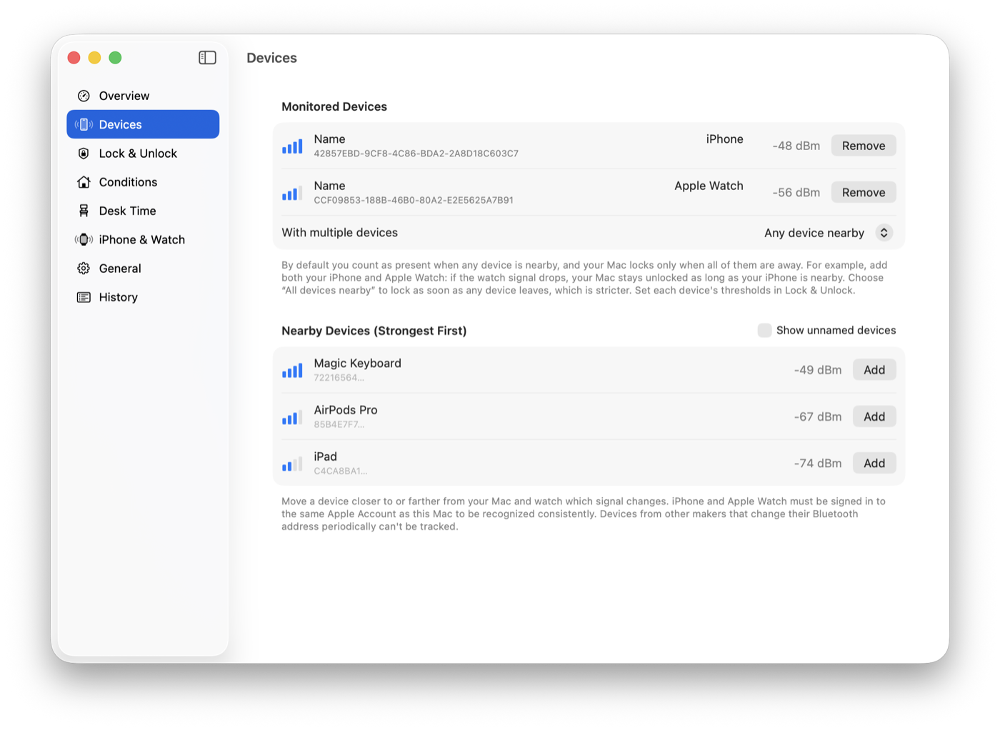
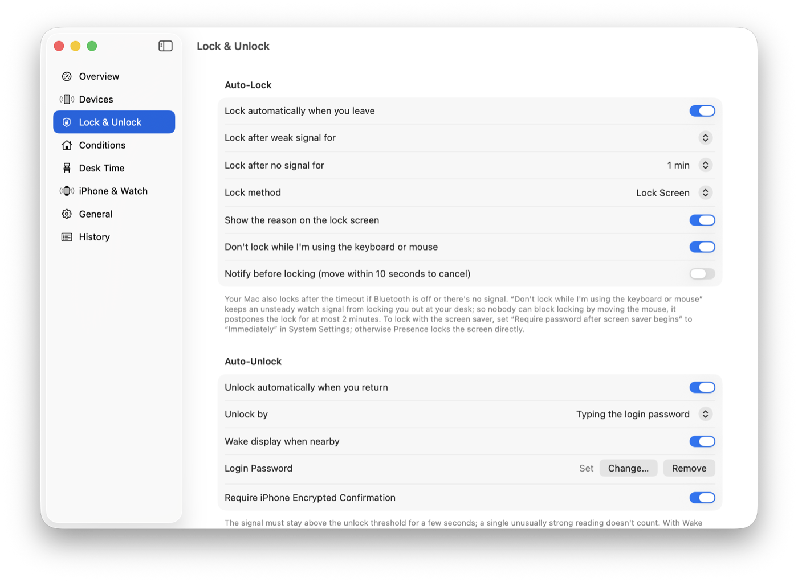
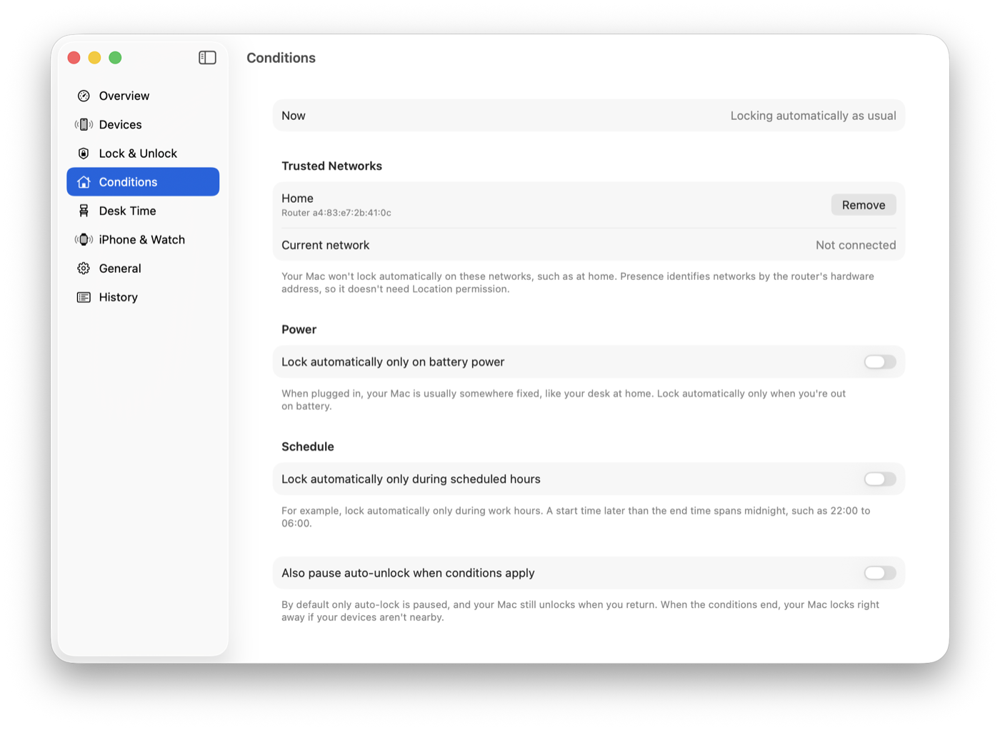
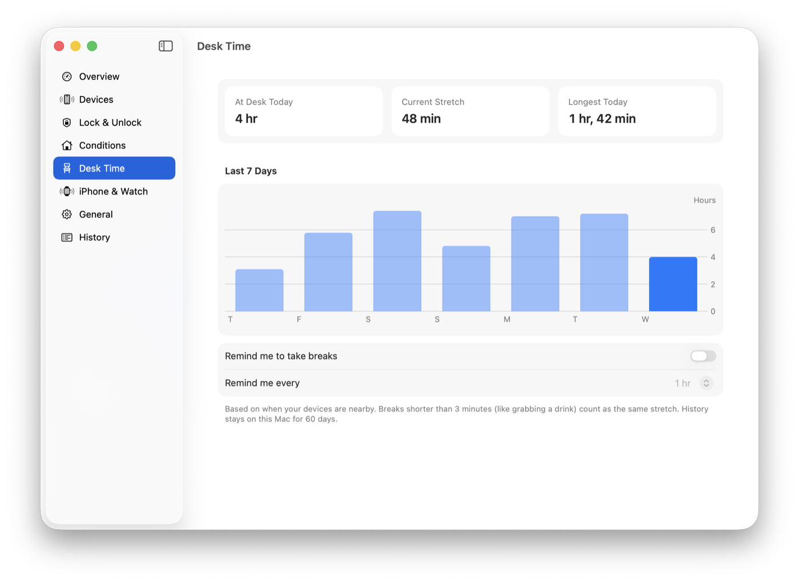
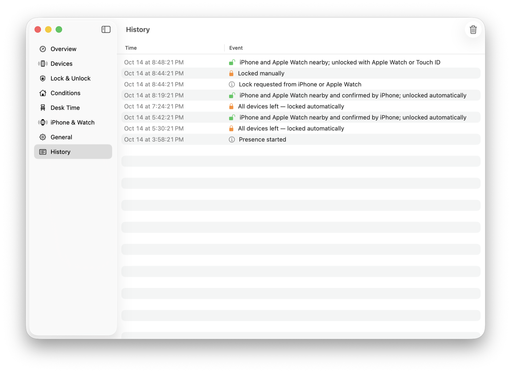
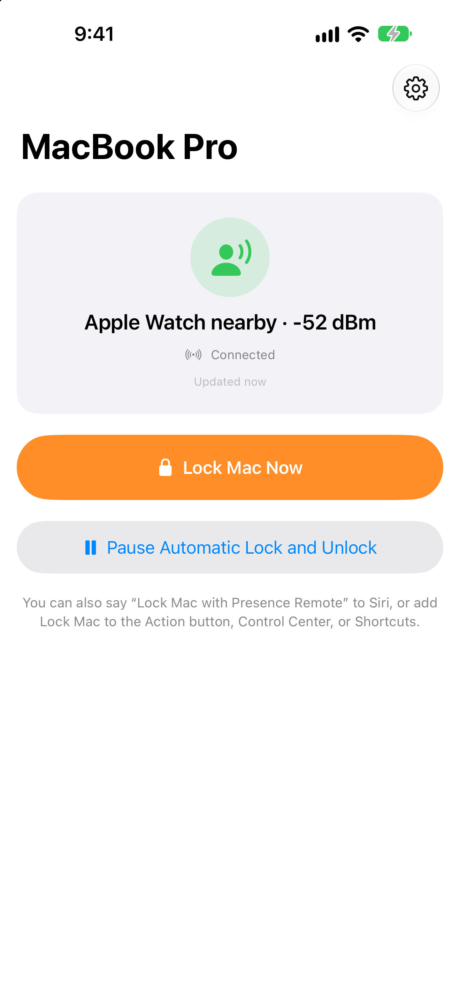
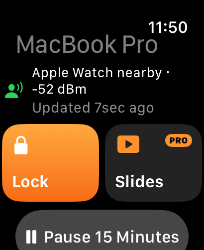

# Presence

[繁體中文](README.md)

Walk away from your desk with your phone and your Mac locks itself. Come back and it unlocks.

Presence is a macOS menu bar app that uses Bluetooth to tell whether your iPhone, Apple Watch, or another BLE device is nearby. It's inspired by [BLEUnlock](https://github.com/ts1/BLEUnlock), redesigned and rewritten for current macOS, and it fixes several security issues in the original.

**No app is needed on your phone or watch.** Presence reads the Bluetooth signal they already send. The companion app, [Presence Remote](#presence-remote-iphone-and-apple-watch), is optional: it adds remote lock, pause, and notifications from your iPhone and Apple Watch, plus an encrypted confirmation before unlocking. Upgrade to Presence Pro and it becomes a presentation clicker too.



https://github.com/user-attachments/assets/f8fd2d65-7006-4385-b623-b9ada55b9a47

## Features

- **Lock when you leave**: when the signal stays below a threshold for a few seconds, or disappears for a while, Presence locks the screen or starts the screen saver.
- **Unlock when you return**: Presence types your login password only after the signal has stayed strong for a few seconds. A single unusually strong reading doesn't count.
- **Encrypted iPhone confirmation**: once you pair Presence Remote, Presence asks your iPhone to answer with the pairing key before it types your password, so a spoofed Bluetooth signal alone can't unlock your Mac.
- **iPhone and Apple Watch remote**: with the Presence Remote companion app, lock, pause, or resume from your iPhone, Apple Watch, Control Center, widgets, or Siri, and get notified when your Mac locks or someone unlocks it while you're away (see [Presence Remote](#presence-remote-iphone-and-apple-watch)).
- **No auto-lock during presentations**: while Keynote, PowerPoint, or [Folium](https://chung223.github.io/folium/) is playing a slideshow, automatic locking pauses. When the show ends and you're away, the Mac locks right away.
- **Presenter Remote**: change slides, jump to a slide, or black out the screen from your iPhone and Apple Watch (Presence Pro, a paid feature of Presence Remote; see [Presenter Remote](docs/presenter-remote.md)). The Mac side stays free and open source.
- **Relaunch after a crash**: if Presence crashes or the system quits it, launchd starts it again. Quitting from the menu doesn't.
- **Multiple devices**: watch an iPhone and an Apple Watch at the same time. Either one nearby counts as you being there, and each device has its own thresholds.
- **Live signal chart**: see every reading and the filtered result, so you can tell where the thresholds should be.
- **One-step calibration**: stand where you want to unlock, then where you want to lock, for 8 seconds each, and Presence works out the thresholds for every device.
- **Context rules**: don't lock automatically on a trusted network (for example at home), while on power, or outside the hours you choose. Networks are identified by the router's hardware address, so no location permission is needed.
- **Pause**: stepping away and don't want to be locked out? Pause for 15 minutes to 4 hours.
- **Hotkey and Shortcuts**: lock with a global hotkey. The Shortcuts app gets Lock Now, Pause, Resume, and Get Status actions.
- **Traditional Chinese and English**; other languages show English.
- **Pause media when locking**, and resume after unlocking.
- **Event scripts**: run your own script when the Mac locks or unlocks (compatible with BLEUnlock).
- **Event history**: see when and why the Mac locked or unlocked, including manual unlocks while your devices were away.
- **Import from BLEUnlock**: bring over your devices and thresholds in one step.

## Screenshots

| | |
|---|---|
|  |  |
| **Overview**: who's nearby, the last 3 minutes of signal, and recent events | **Devices**: watch your iPhone and Apple Watch together, each with its own thresholds |
|  |  |
| **Lock & Unlock**: how to lock, auto-unlock, and iPhone confirmation | **Conditions**: don't lock at home, on power, or outside set hours |
|  |  |
| **Desk Time**: time at your desk today, the last 7 days, and break reminders | **History**: when and why your Mac locked or unlocked |

## Requirements

- macOS 26 or later (tested so far only on macOS 26.7 on Apple silicon)
- A Mac with Bluetooth LE
- An iPhone, Apple Watch, or a BLE device that advertises regularly with a fixed Bluetooth address

## Install

Download `Presence-<version>.zip` from [Releases](https://github.com/chung223/Presence/releases/latest), unzip it, drag Presence into the Applications folder, and open it. The app is notarized by Apple, and later versions update automatically through Sparkle.

**Keep it in the Applications folder.** Run from Downloads or an external drive, macOS may quit it during sleep, and it may fail to start at login. If it's in the wrong place, Presence tells you and can move itself.

Presence Remote for iPhone and Apple Watch has been submitted to the App Store; a link will go here once it's available. Until then you can build it from source (see [Development](#development)).

To build the Mac app from source:

```bash
brew install xcodegen
xcodegen generate
xcodebuild -project Presence.xcodeproj -scheme Presence -configuration Release build
```

## First-time setup

When you open Presence, the main window lists the steps you haven't finished yet:

1. **Bluetooth**: choose Allow when macOS asks.
2. **Choose devices**: on the Devices page, move your phone closer to and farther from the Mac and watch which signal follows it. Your iPhone and Apple Watch must be signed in to the same Apple Account as the Mac for the Mac to recognize them.
3. **Accessibility**: automatic unlocking types your password, so turn on Presence in System Settings › Privacy & Security › Accessibility.
4. **Login password**: Presence checks that the password is correct, then saves it in your Keychain.

If you use BLEUnlock, turn off its Launch at Login and quit it first. Running both at once makes them interfere with each other.

## Presence Remote (iPhone and Apple Watch)

<p>


</p>

Presence Remote is the companion app for Presence. It connects straight to your Mac over Bluetooth, with no account and no internet connection. Presence locks and unlocks automatically without it; installing it adds the following.

- **Lock your Mac now** from the app, Apple Watch, Control Center, the Action button, Siri, or Shortcuts.
- **Pause and resume** automatic locking and unlocking for 15 minutes to 4 hours, or resume at any time (unlock your iPhone first).
- **See the status**: whether you're nearby and whether the Mac is locked, also on Home Screen and Lock Screen widgets and watch face complications.
- **Notifications** when your Mac locks because you left, or someone unlocks it by hand while you're away.
- **Encrypted confirmation before unlocking**: your Mac asks your iPhone to answer with the pairing key before it types your password (see [How it works](#how-it-works-and-security)).

**Presenter Remote (Presence Pro)**: turn your iPhone and Apple Watch into a presentation clicker. Tap or swipe to change slides; jump to a slide, black out the screen, start and end the show; change slides from the Lock Screen and Dynamic Island while your phone is locked; on the watch, tap, turn the Digital Crown, or double tap; a talk timer taps you at 5 minutes left and when time is up; and automatic locking pauses during the talk. Turn on Allow Presenter Remote under iPhone & Watch on your Mac first. How it works, and how other apps can support it: [docs/presenter-remote.md](docs/presenter-remote.md) (in Chinese).

Presence Pro is an in-app purchase: monthly or yearly (both with a 7-day free trial) or a one-time purchase, all shareable with Family Sharing. Locking, pausing, notifications, widgets, and the Mac app are free.

**Pairing**: in Presence on your Mac, open iPhone & Watch, click Pair New iPhone…, and scan the QR code with Presence Remote. Your Apple Watch gets the pairing through that iPhone, so there's nothing else to set up.

Requires iOS 26 and watchOS 26 or later. It works only within Bluetooth range, roughly the same room.

If you delete the app after pairing, unpair it in iPhone & Watch on your Mac, or turn off Require iPhone Encrypted Confirmation in Lock & Unlock. Otherwise your Mac keeps waiting for a confirmation that never comes and won't type your password, so you'll have to unlock with your Apple Watch, Touch ID, or password.

## How it works and security

**Nearby or not**: Presence takes the median of the last 4 seconds of readings and needs at least 3 samples. The lock threshold is lower than the unlock threshold (hysteresis), so it doesn't flip back and forth at the boundary.

**Never unlock when the state is unknown**: right after launch, after waking from sleep, when Bluetooth is off, or after switching devices, Presence throws away old readings and unlocks only after enough new ones arrive. The original BLEUnlock reused the state from before sleep.

**No signal means lock**: if Bluetooth is turned off or your devices disappear for longer than the timeout, the Mac still locks, so protection doesn't silently stop. If you're away when a pause or context rule ends, it locks right away.

**No URL scheme**: any web page can open a URL scheme, which would let a web page pause your automatic locking. Use the Shortcuts actions for automation.

**Unlocking**: wake the screen → wait a few seconds so macOS's built-in Apple Watch unlock gets the first chance → type the password only if the Mac is still locked. Unlocking with the watch is safer and doesn't race with Presence's typing. The wait is 5 seconds by default and drops to 1.5 seconds after several unlocks in a row where the watch didn't get there first. Before each group of characters and before pressing Return, Presence checks that the Mac is still locked and the login window is in front. If you unlock first with Touch ID or your Apple Watch, Presence stops typing right away, so your password never ends up in another app (the original's [#182](https://github.com/ts1/BLEUnlock/issues/182)). For a minute after unlocking, Presence keeps the display from dimming for inactivity, so the Mac doesn't lock again right after it opens.

**When to unlock**: Presence tries only when the signal has just gone from not close enough to close enough (you walked back), or when the screen wakes up (you touched the keyboard or mouse). After two failures in a row it stops unlocking automatically until you unlock once by hand, so wrong-password attempts don't pile up.

**Manual lock**: after you lock with Presence's Lock Now, you have to be away for more than 30 seconds before it unlocks automatically again; a brief dip in signal doesn't count (the original's [#137](https://github.com/ts1/BLEUnlock/issues/137)).

**Password**: stored in your Keychain, read only at the moment of unlocking, and never written to any log.

**Encrypted confirmation**: judging by signal strength alone, anyone who spoofs your phone's Bluetooth advertisement could unlock your Mac. With an iPhone paired, Presence sends a random 128-bit challenge before typing the password, and accepts only a reply encrypted with the pairing key and returned in time. Every challenge is different and accepted once. If the iPhone isn't connected or doesn't answer, Presence doesn't unlock, and you unlock with your Apple Watch, Touch ID, or password instead. This doesn't stop a relay attack that forwards your phone's signal from far away (see [docs/companion-app.md](docs/companion-app.md), in Chinese).

What macOS 26.7 actually does in each of these situations is recorded in [docs/macos26-findings.md](docs/macos26-findings.md) (in Chinese).

## Privacy

Presence and Presence Remote collect no data: no accounts, no servers, no analytics, and your devices talk to each other only over Bluetooth. The Mac app only reads its update feed from GitHub. See the [privacy policy](docs/privacy.md).

## Event scripts

Put an executable at `~/Library/Application Scripts/com.chung.presence/event`. Presence runs it with an argument when it locks or unlocks:

| Argument | When |
|---|---|
| `away` | Locked because the signal got weak |
| `lost` | Locked because the signal disappeared |
| `unlocked` | Presence unlocked automatically |
| `intruded` | Someone unlocked by hand while your devices were away |

The second argument is the signal strength at that moment (dBm).

## Development

```bash
# Unit tests for the presence logic
cd Packages/PresenceCore && swift test

# Regenerate the app icon (add ios or watchos for the iPhone and watch icons)
swift scripts/make-icon.swift Presence/Assets.xcassets/AppIcon.appiconset

# iPhone and watch apps (with widgets), using Xcode automatic signing
xcodebuild -project Presence.xcodeproj -scheme PresenceRemote -destination 'generic/platform=iOS' \
    -derivedDataPath build-ios -allowProvisioningUpdates build

# Release a new Mac version: update MARKETING_VERSION and CURRENT_PROJECT_VERSION in project.yml, commit and push, then run
scripts/release.sh

# Screenshots and promo video for the README, made with the debug build's demo mode (fake devices,
# simulated signal). Don't touch the mouse or keyboard while they run.
scripts/promo/screenshots.sh
scripts/promo/video.sh
```

`scripts/release.sh` signs with Developer ID, sends the app to Apple for notarization, creates a Sparkle update feed signed with EdDSA, and drafts a GitHub release. The private key for signing updates is in the publisher's Keychain (Sparkle's `generate_keys`). If it's lost, existing users stop receiving updates, so back it up separately (`generate_keys -x <file>`).

`Packages/PresenceCore` is pure logic with no system APIs (when you count as nearby, when to lock, when to try unlocking). The app only connects it to Bluetooth, screen state, and user actions.

## Thanks

Thanks to Takeshi Sone for [BLEUnlock](https://github.com/ts1/BLEUnlock) (MIT license). Presence follows its approach and event script format; the code is a rewrite.

## License

MIT. See [LICENSE](LICENSE).
