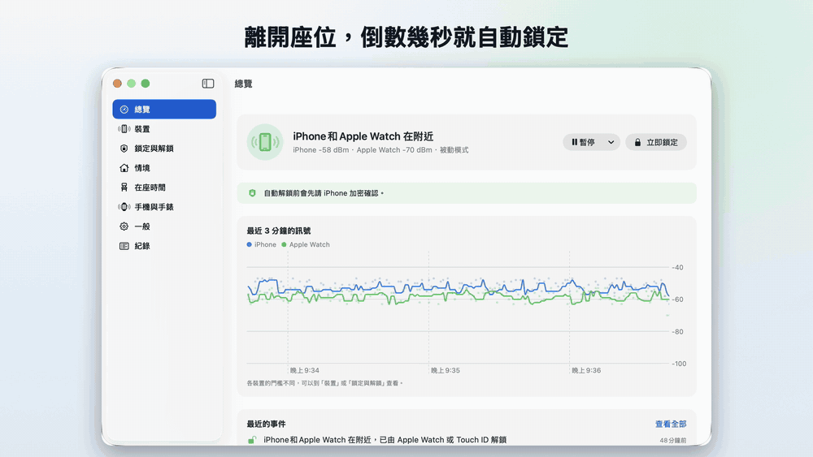
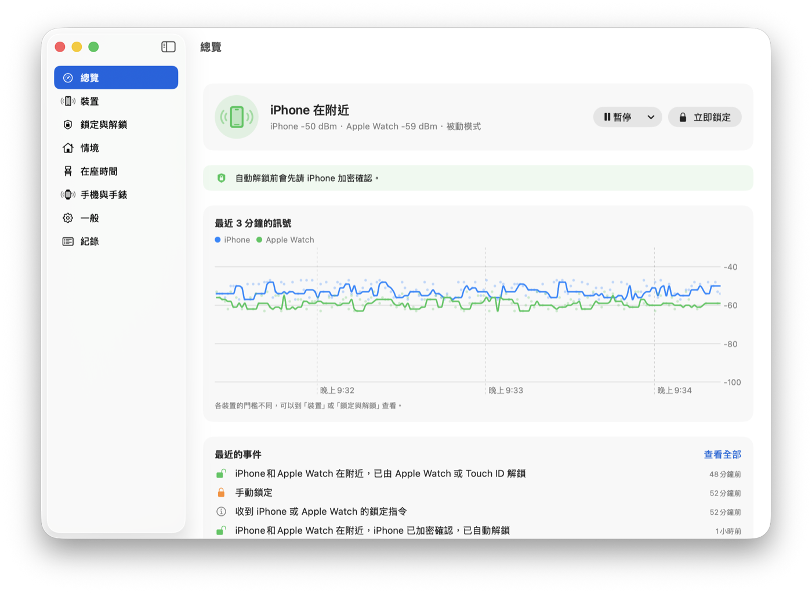
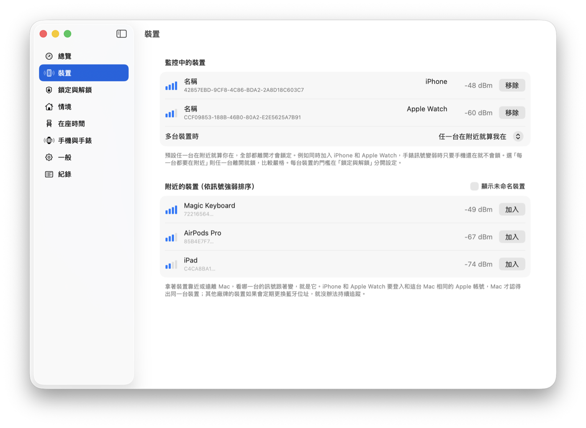
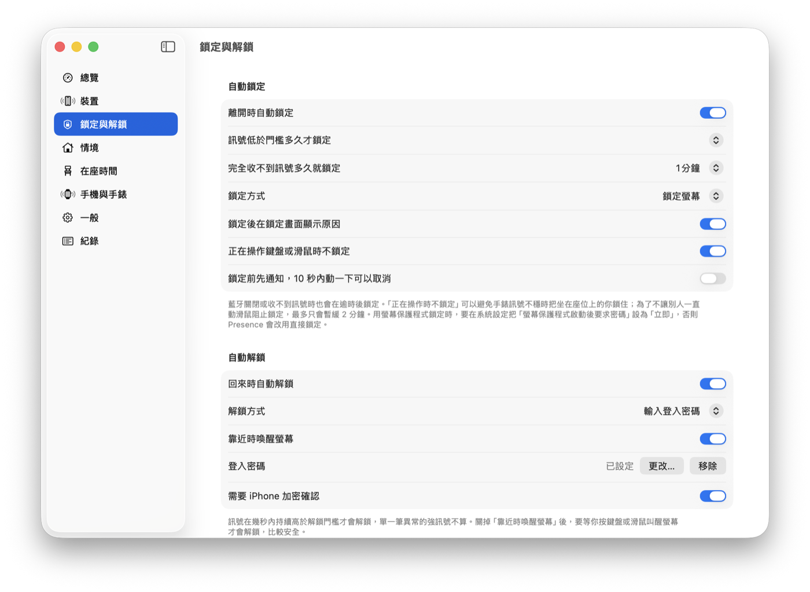
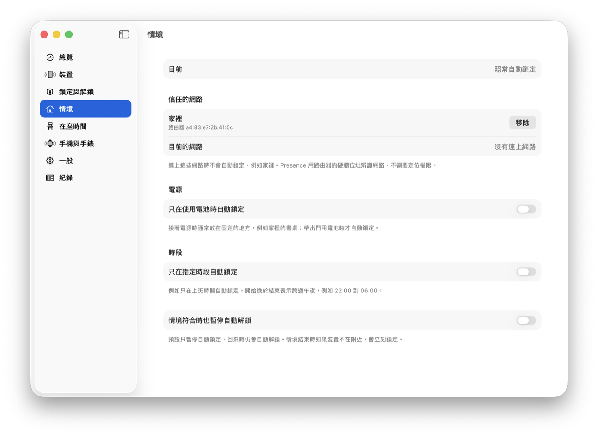
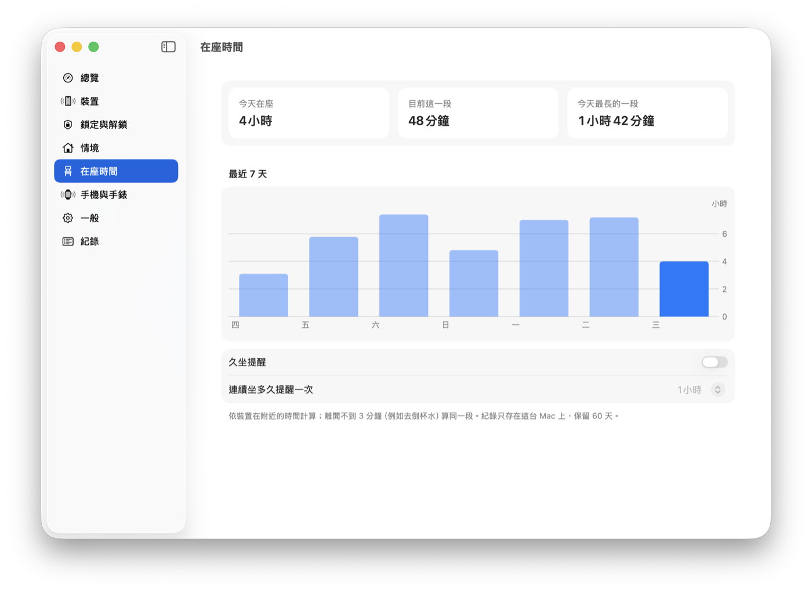
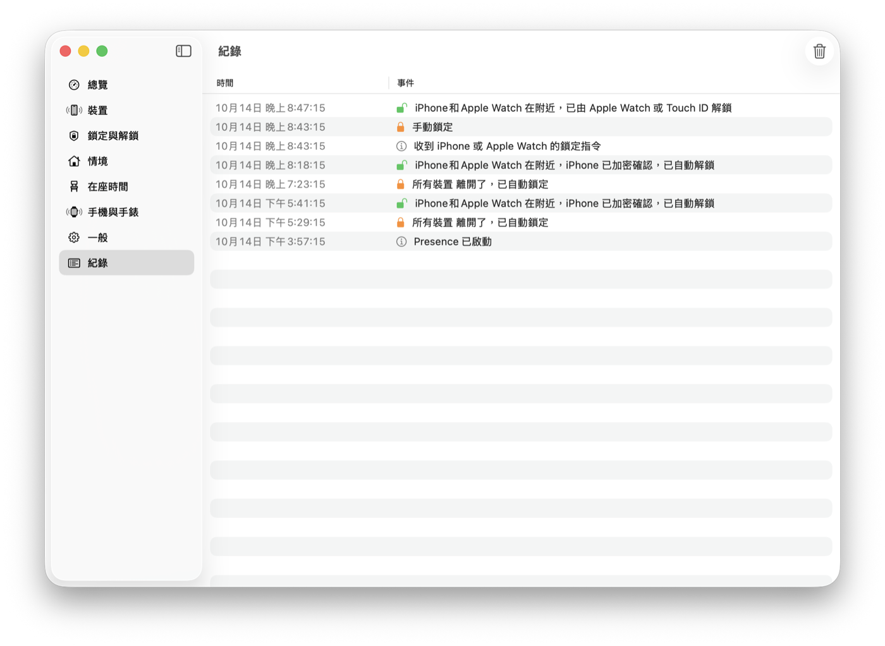
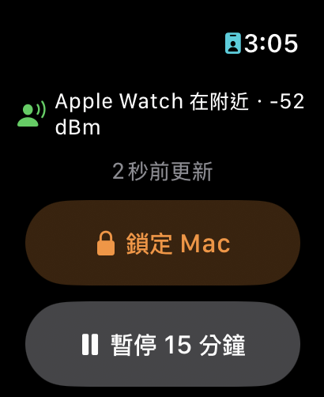

# Presence

[English](README.en.md)

帶著手機離開座位，Mac 自動鎖定；走回來，自動解鎖。

Presence 是 macOS 選單列工具，用藍牙偵測你的 iPhone、Apple Watch 或其他 BLE 裝置在不在附近。想法來自 [BLEUnlock](https://github.com/ts1/BLEUnlock)，針對新版 macOS 重新設計與實作，並修正了原版幾個安全問題。

**手機和手錶不用裝任何 App**：Presence 讀的是它們本來就會發出的藍牙訊號。配套的 [Presence Remote](#presence-remoteiphone-與-apple-watch) 是選用的，裝了可以從手機和手錶遠端鎖定、暫停、收通知，並在解鎖前加密確認。



https://github.com/user-attachments/assets/ed99e2bb-de2b-4e57-80bd-02ce0df88796

## 功能

- **離開自動鎖定**：訊號持續低於門檻幾秒、或完全收不到訊號一段時間，就鎖定螢幕或啟動螢幕保護程式。
- **回來自動解鎖**：訊號在幾秒內持續夠強，才輸入登入密碼解鎖；單一筆異常的強訊號不會觸發。
- **iPhone 加密確認**：配對 Presence Remote 後，輸入密碼前會先請 iPhone 用配對金鑰回應，只偽造藍牙訊號無法讓 Mac 解鎖。
- **iPhone 與 Apple Watch 遙控**：用配套 App Presence Remote，從手機、手錶、控制中心、小工具或 Siri 立即鎖定、暫停或恢復；Mac 自動鎖定或有人趁你不在手動解鎖時，iPhone 會收到通知（見下方「Presence Remote」）。
- **意外結束自動重開**：當機或被系統結束時，launchd 會把它重新開起來；從選單結束則不會。
- **多裝置**：同時監控 iPhone 和 Apple Watch，任一台在附近就算你在；每台裝置有自己的門檻。
- **即時訊號圖**：看得到每一筆訊號和濾波後的結果，門檻設多少一目了然。
- **一鍵校準**：分別站在希望解鎖、希望鎖定的位置量 8 秒，同時算出每台裝置的門檻。
- **依情境暫停**：連上信任的網路（例如家裡）、接著電源、或不在指定時段時，不自動鎖定。網路用路由器的硬體位址辨識，不需要定位權限。
- **暫停**：暫時離開座位又不想被鎖，可以暫停 15 分鐘到 4 小時。
- **快捷鍵與捷徑**：自訂全域快捷鍵立即鎖定；「捷徑」App 有立即鎖定、暫停、恢復、取得狀態四個動作。
- **繁體中文與英文介面**，其他語言顯示英文。
- **鎖定時暫停播放**，解鎖後繼續。
- **事件腳本**：鎖定或解鎖時執行你自己的腳本（與 BLEUnlock 相容）。
- **事件紀錄**：什麼時候、為什麼鎖定或解鎖，都查得到；裝置不在時被手動解鎖也會記下來。
- **沿用 BLEUnlock 的設定**：一鍵匯入裝置與門檻。

## 畫面

| | |
|---|---|
|  |  |
| **總覽**：誰在附近、最近 3 分鐘的訊號和最近的事件 | **裝置**：同時監控 iPhone 和 Apple Watch，各自的門檻 |
|  |  |
| **鎖定與解鎖**：鎖定方式、自動解鎖與 iPhone 加密確認 | **情境**：在家、接著電源或時段外不自動鎖定 |
|  |  |
| **在座時間**：今天坐了多久、最近 7 天、久坐提醒 | **紀錄**：每次鎖定、解鎖的時間和原因 |

## 系統需求

- macOS 26 以上（目前只在 macOS 26.7、Apple Silicon 上測試過）
- 支援藍牙 LE 的 Mac
- iPhone、Apple Watch，或會定期廣播、藍牙位址固定的 BLE 裝置

## 安裝

到 [Releases](https://github.com/chung223/Presence/releases/latest) 下載 `Presence-版本.zip`，解壓縮後把 Presence 拖進「應用程式」資料夾再打開。App 已經過 Apple 公證，之後的新版會透過 Sparkle 自動更新。

**一定要放在「應用程式」資料夾**：從「下載」或外接硬碟執行，系統可能在睡眠時把它結束，登入時也開不起來。放錯地方時，Presence 會提醒你並可以一鍵移過去。

iPhone 與 Apple Watch 的 Presence Remote 已送 App Store 審核，上架後會在這裡附上連結；在那之前要從原始碼建置（見「開發」）。

也可以從原始碼建置 Mac 版：

```bash
brew install xcodegen
xcodegen generate
xcodebuild -project Presence.xcodeproj -scheme Presence -configuration Release build
```

## 第一次設定

打開 Presence 後，主視窗會列出還沒完成的步驟：

1. **藍牙權限**：系統詢問時選「允許」。
2. **選擇裝置**：在「裝置」頁拿著手機靠近或遠離 Mac，看哪一台的訊號跟著變。iPhone 和 Apple Watch 要登入和 Mac 相同的 Apple 帳號，Mac 才認得出同一台裝置。
3. **輔助使用權限**：自動解鎖要模擬鍵盤輸入密碼，需要在「系統設定 › 隱私權與安全性 › 輔助使用」打開 Presence。
4. **登入密碼**：Presence 會先確認密碼正確，再存進鑰匙圈。

如果你在用 BLEUnlock，請先在它的選單關掉「登入時啟動」並結束它，兩個同時執行會互相干擾。

## Presence Remote（iPhone 與 Apple Watch）

<p>


</p>

Presence Remote 是 Presence 的配套 App，透過藍牙直接連到你的 Mac，不需要帳號或網路。不裝也能使用 Presence 的自動鎖定與解鎖；裝了多了下面這些功能。

- **立即鎖定 Mac**：從 App、Apple Watch、控制中心、動作按鈕、Siri 或「捷徑」。
- **暫停與恢復**：暫停自動鎖定與解鎖 15 分鐘到 4 小時，或隨時恢復（要先解鎖 iPhone）。
- **查看狀態**：你在不在附近、Mac 有沒有鎖著；主畫面與鎖定畫面小工具、手錶錶面複雜功能都看得到。
- **通知**：Mac 因為你離開而自動鎖定、或你不在附近時被人手動解鎖，iPhone 會收到通知。
- **解鎖前的加密確認**：Mac 要輸入密碼前，會先請 iPhone 用配對金鑰回應（見「運作方式與安全設計」）。

**配對**：在 Mac 的 Presence 打開「手機與手錶」，按「配對新的 iPhone…」，再用 Presence Remote 掃描畫面上的 QR code。Apple Watch 會透過這支 iPhone 取得配對，不用另外設定。

需要 iOS 26、watchOS 26 以上。只在藍牙範圍內（大約同一個房間）有效。

配對後如果把 App 刪掉，請在 Mac 的「手機與手錶」取消配對，或在「鎖定與解鎖」關掉「需要 iPhone 加密確認」。否則 Mac 會一直等不到 iPhone 的確認，就不會自動輸入密碼，只能用 Apple Watch、Touch ID 或密碼解鎖。

## 運作方式與安全設計

**判斷在不在附近**：取最近 4 秒訊號的中位數，至少要有 3 筆樣本。鎖定門檻要低於解鎖門檻（遲滯），避免在邊界反覆鎖定、解鎖。

**狀態未知時一律不解鎖**：剛啟動、系統睡眠醒來、藍牙關閉或換了裝置時，會清掉舊的訊號，重新收到足夠的新訊號後才會解鎖。原版 BLEUnlock 會沿用睡眠前的狀態。

**收不到訊號就鎖定**：藍牙關閉或裝置訊號消失超過逾時時間，會照常鎖定，不會因此停止保護。暫停或情境結束時如果你不在，也會立刻補鎖。

**不提供 URL scheme**：任何網頁都能觸發 URL scheme，等於讓網頁可以暫停你的自動鎖定。自動化請用「捷徑」動作。

**解鎖流程**：喚醒螢幕 → 先等幾秒，讓 macOS 內建的「用 Apple Watch 解鎖」有機會先解開 → 還鎖著才輸入密碼。手錶解鎖比較安全，也不會跟 Presence 打字互搶。預設等 5 秒；如果連續幾次都沒有手錶先解開，就縮短成 1.5 秒。每送出一段字元前、按 Enter 前，都會確認「仍在鎖定」而且「前景是登入畫面」。如果你在這期間用 Touch ID 或 Apple Watch 先解鎖了，Presence 會立刻停止輸入，密碼不會被打進其他 App（原版的 [#182](https://github.com/ts1/BLEUnlock/issues/182)）。解鎖後一分鐘內不讓螢幕因為閒置而變暗，避免剛解開又被系統鎖回去。

**解鎖時機**：只在訊號剛從不夠近變成夠近（你走回來了），或螢幕被喚醒（你碰了鍵盤滑鼠）時嘗試。連續失敗兩次就停止自動解鎖，直到你手動解鎖一次，避免密碼錯誤累積。

**手動鎖定**：用 Presence 的「立即鎖定」鎖定後，要離開超過 30 秒再回來才會自動解鎖，訊號短暫變弱不算（原版的 [#137](https://github.com/ts1/BLEUnlock/issues/137)）。

**密碼**：存在鑰匙圈，只在解鎖那一刻讀出，不會寫進任何紀錄。

**加密確認**：只看訊號強弱的話，偽造你手機的藍牙廣播就能讓 Mac 解鎖。配對了 iPhone 時，Presence 在輸入密碼前會送出一個隨機的 128 位元挑戰，只有用配對金鑰加密、在時限內原樣送回的回應才算數；挑戰每次不同、只收一次。iPhone 沒有連上或沒有回應時就不自動解鎖，改由你用 Apple Watch、Touch ID 或密碼解鎖。這擋不了把你手機訊號轉送到遠處的中繼攻擊（見 [docs/companion-app.md](docs/companion-app.md)）。

各項系統行為在 macOS 26.7 的實測結果見 [docs/macos26-findings.md](docs/macos26-findings.md)。

## 隱私

Presence 與 Presence Remote 不收集任何資料：沒有帳號、伺服器或分析工具，裝置之間只用藍牙直接溝通。Mac 版只會向 GitHub 讀取更新清單。詳見[隱私權政策](docs/privacy.md)。

## 事件腳本

在 `~/Library/Application Scripts/com.chung.presence/event` 放一個可執行檔，鎖定或解鎖時會帶參數執行：

| 參數 | 時機 |
|---|---|
| `away` | 訊號變弱而鎖定 |
| `lost` | 收不到訊號而鎖定 |
| `unlocked` | Presence 自動解鎖 |
| `intruded` | 裝置不在附近時，有人手動解鎖 |

第二個參數是當時的訊號強度（dBm）。

## 開發

```bash
# 判斷邏輯的單元測試
cd Packages/PresenceCore && swift test

# 重新產生 App 圖示（iPhone、手錶分別加 ios、watchos）
swift scripts/make-icon.swift Presence/Assets.xcassets/AppIcon.appiconset

# iPhone 與手錶 App（含小工具），用 Xcode 自動簽章
xcodebuild -project Presence.xcodeproj -scheme PresenceRemote -destination 'generic/platform=iOS' \
    -derivedDataPath build-ios -allowProvisioningUpdates build

# 發佈 Mac 新版：先改 project.yml 的 MARKETING_VERSION 與 CURRENT_PROJECT_VERSION，commit 並 push 後執行
scripts/release.sh

# README 的截圖與宣傳影片：用開發版的示範模式（假裝置、模擬訊號），期間不要碰滑鼠鍵盤
scripts/promo/screenshots.sh
scripts/promo/video.sh
```

`scripts/release.sh` 會用 Developer ID 簽章、送 Apple 公證、產生用 EdDSA 簽章的 Sparkle 更新清單，並在 GitHub 建立 Release 草稿。簽更新用的私鑰在發佈者的鑰匙圈（Sparkle 的 `generate_keys`），弄丟的話已安裝的人就收不到更新，請另外備份（`generate_keys -x 檔名`）。

`Packages/PresenceCore` 是不碰系統 API 的純邏輯（何時算在附近、何時鎖定、何時嘗試解鎖），App 只負責把藍牙、螢幕狀態和使用者操作接上去。

## 致謝

感謝 Takeshi Sone 的 [BLEUnlock](https://github.com/ts1/BLEUnlock)（MIT 授權）。Presence 沿用了它的做法與事件腳本格式，程式碼為重新撰寫。

## 授權

MIT，見 [LICENSE](LICENSE)。
